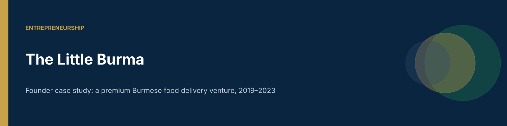
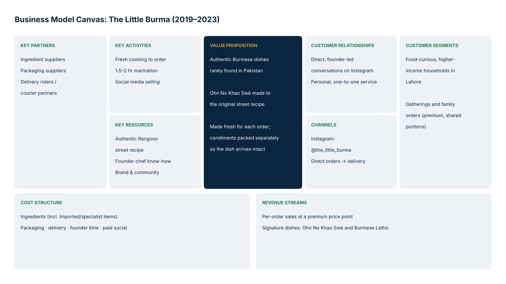
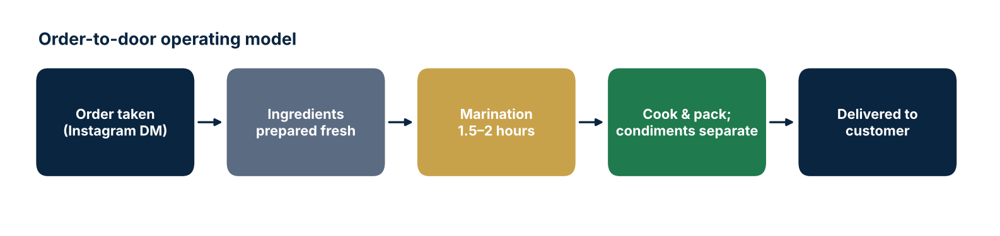

# The Little Burma: Founder Case Study

**A real venture I founded and ran.** The Little Burma was a premium Burmese food delivery business in Lahore, Pakistan, which I operated from August 2019 to July 2023. This case study sets out the business model, how it was run, and a strategic review of it using the frameworks from my MSc in Business Strategy & Entrepreneurship.

> **What's factual and what's analysis.** Sections 1–4 describe the business as it ran. Sections 5–6 are my own retrospective analysis. Financial results are not published.

---

## 1. Snapshot

| | |
|---|---|
| **Business** | Premium Burmese food, cooked to order and delivered |
| **Market** | Lahore, Pakistan: food-curious, higher-income households and gatherings |
| **Founded / operated** | August 2019 – July 2023 |
| **My role** | Founder and chef: product, pricing, marketing, ordering and fulfilment |
| **Signature products** | **Ohn No Khao Swè** (coconut curry noodle soup, made to the original Rangoon street recipe) and **Burmese Letho** (a vegan-friendly noodle dish built on a blend of 27 ingredients with a tangy tamarind sauce) |
| **Channel** | Instagram ([@the_little_burma](https://www.instagram.com/the_little_burma/)): discovery, ordering and customer conversations |
| **Recognition** | Featured in several publications |

## 2. The opportunity

Burmese cuisine was rarely available in Pakistan. That gave the venture a clear point of difference in a crowded delivery market where most menus compete on the same dishes and on price. The bet was that a **narrow, authentic and premium** offer could build a loyal following among customers who value novelty and quality over discounts.

## 3. Business model

**Positioning:** authentic over adapted. The recipe was not localised. Authenticity was the product, and the premium price point signalled it.

## 4. Operating model

- **Made to order:** every order cooked fresh, with 1.5–2 hours of marination. This protects quality but caps daily capacity, a deliberate trade-off.
- **Packed to travel:** condiments (spring onions, boiled egg, roasted garlic, noodle crisps, chilli flakes) are packed separately so the dish arrives as intended.
- **Founder-led selling:** orders and questions handled personally on Instagram, building direct relationships and word of mouth.
- **Targeted promotion:** paid social aimed at the customer segments and Lahore neighbourhoods most likely to value a premium, unusual cuisine.

## 5. Strategic review (retrospective analysis)

### What the model did well

| Strength | Why it mattered |
|---|---|
| Clear differentiation | Hard to copy quickly; gave customers a reason to talk about the brand |
| Premium positioning | Avoided price competition with mainstream delivery |
| Direct customer channel | Low channel cost and direct feedback, without aggregator commission |
| Product discipline | A short menu kept quality consistent and ingredients manageable |

### Structural constraints

| Constraint | Effect |
|---|---|
| Made-to-order prep and marination time | Capacity tied to founder time; hard to scale volume |
| Founder-dependent operations | The business could not run without me in the kitchen |
| Single-city, single-channel | Growth limited to one city and one platform's reach |

### Growth options (Ansoff matrix)

| | Existing products | New products |
|---|---|---|
| **Existing market (Lahore)** | *Market penetration:* corporate and event catering; pre-booked weekend slots to smooth demand | *Product development:* ready-to-cook kits and bottled sauces; longer shelf life, less prep per sale |
| **New markets** | *Market development:* Karachi / Islamabad via a partner kitchen; diaspora markets such as the UAE (see [Market Entry Strategy](https://github.com/sohaibshabbir9-del/market-entry-strategy-uae)) | *Diversification:* pop-ups and a supper-club format; higher risk, brand-building value |

**My assessment:** the strongest next step would have been **product development**: packaged sauces and kits. They turn the hard-to-copy recipe into a product that does not depend on the founder's time in the kitchen, and they open retail and online channels.

## 6. What running it taught me

- **Positioning is a decision, not a slogan.** Choosing not to localise the recipe shaped pricing, customers and marketing.
- **Unit economics come before growth.** Capacity, prep time and ingredient cost set the ceiling long before demand does.
- **Owning the customer relationship matters.** Talking to customers directly gives faster, more honest feedback than any dashboard.
- **Systems beat heroics.** A founder-dependent business is a job, not an asset. Documenting processes is what makes it scalable or sellable.

---

Prepared by <a href="https://github.com/sohaibshabbir9-del">Sohaib Shabbir</a>, founder of The Little Burma · Entrepreneurship & business models.
